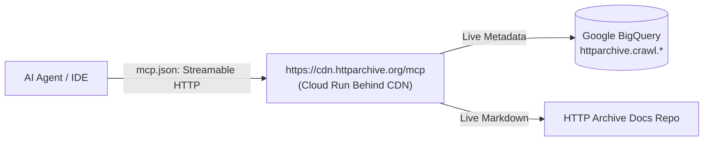

# HTTP Archive Agent Plugin

[](https://github.com/httparchive/httparchive-plugin/actions/workflows/ci.yml)
[](https://agent-plugins.org/)
[](LICENSE)

An official agent plugin conforming to the [Agent Plugins Specification (v1.0.0)](https://agent-plugins.org/) for querying the [HTTP Archive](https://httparchive.org) dataset in Google Cloud BigQuery.

Instead of bundling local scripts or static catalogs that become outdated quickly, this plugin connects to HTTP Archive's production **remote Streamable HTTP MCP server** (`https://cdn.httparchive.org/mcp`) backed directly by live BigQuery APIs and official HTTP Archive documentation.

---

## Zero-Configuration Remote Architecture

Clients require **no local GCP credentials**, **no local BigQuery SDK installations**, and **no local background processes**. The plugin connects directly to HTTP Archive's cloud endpoint over Streamable HTTP:



---

## Capabilities

### 1. Remote Model Context Protocol (MCP) Tools
The remote endpoint (`https://cdn.httparchive.org/mcp`) exposes 5 live introspection and cost validation tools:

| Tool | Source of Truth | Description | Cost |
|---|---|---|---|
| `get_table_schema` | **Live BigQuery API + Docs** | Queries BigQuery table metadata directly for column types, partitioning (`date`), clustering hierarchy, and links to official documentation. | $0.00 |
| `list_custom_metrics` | **Live BigQuery Schema & Data** | Introspects the live `custom_metrics` RECORD in BigQuery `crawl.pages`, and samples real JSON property keys via `sample_data.pages_10k` Tabledata API. | $0.00 |
| `preview_table_rows` | **Live BigQuery Tabledata API** | Previews actual live rows at zero cost without executing query jobs or scanning bytes. | $0.00 |
| `analyze_query_cost` | **Live BigQuery Dry-Run API** | Runs a live BigQuery dry-run (`dryRun: true`) returning exact bytes processed, estimated USD cost, and applies domain cost rules (partitioning, clustering order, `SELECT *` traps, `LIMIT` traps). | $0.00 |
| `get_documentation` | **HTTP Archive Docs Source** | Dynamically fetches official documentation guides (`minimizing-costs`, `getting-started`, `release-cycle`), table reference docs (`pages`, `requests`), struct reference docs (`custom-metrics`, `technology`), and SQL function docs (`capo`, `get_origin`). | $0.00 |

### 2. Agent Skills
Located under `skills/` adhering to the [Agent Skills specification](https://agentskills.io/):

- **[`httparchive-table-schema`](skills/httparchive-table-schema/SKILL.md)**:
  - Guides agents to use `get_table_schema`, `list_custom_metrics`, and `get_documentation` to discover live structures rather than guessing.
  - Unnesting patterns for `technologies` (`ARRAY<STRUCT>`) and `features` (`ARRAY<STRUCT>`).
  - Structured `RECORD` column storage for `custom_metrics` vs internal `JSON` path extraction.
  - Safe join patterns between pages and requests.
- **[`httparchive-cost-optimization`](skills/httparchive-cost-optimization/SKILL.md)**:
  - Grounded in the official [Minimizing Costs Guide](https://httparchive.org/docs/guides/minimizing-costs/).
  - The 5 core optimization rules (mandatory `date` partition, clustering hierarchy, column projection hygiene, the `LIMIT` trap).
  - Explains the BigQuery dry-run estimation limitation on clustered `rank` filters.
  - The 5-step safe prototyping progression (`preview_table_rows` → `sample_data.pages_10k` → `TABLESAMPLE` → clustered slice → production run).

---

## Directory Structure

```text
httparchive-plugin/
├── plugin.json                              # Agent Plugins v1.0.0 root manifest
├── mcp.json                                 # Remote Streamable HTTP MCP configuration
├── skills/
│   ├── httparchive-table-schema/
│   │   └── SKILL.md                         # Live schema exploration guide
│   └── httparchive-cost-optimization/
│       └── SKILL.md                         # Cost minimization playbook
├── tests/
│   └── plugin.test.js                       # Manifest, skills, & MCP endpoint tests
├── scripts/
│   ├── validate-spec.js                     # Validates plugin against agent-plugins.org schemas
│   └── schemas/1.0.0/                       # Canonical Agent Plugins JSON schemas
└── .github/workflows/
    └── ci.yml                               # GitHub Actions CI workflow
```

---

## Installation & Configuration

### In Any Agent Plugins Compatible Client (Cursor, Claude Desktop, Antigravity, Jules)

Add the plugin directory to your agent's plugin discovery path or include `mcp.json` in your client configuration:

```json
{
  "$schema": "https://agent-plugins.org/schemas/1.0.0/mcp.schema.json",
  "mcpServers": {
    "httparchive": {
      "type": "streamable-http",
      "url": "https://cdn.httparchive.org/mcp"
    }
  }
}
```

---

## Development & Testing

```bash
# Install test/lint dependencies
npm install

# Run unit tests
npm test

# Run Agent Plugins specification validator
npm run validate:spec

# Run linter
npm run lint
```

---

## License

[Apache 2.0](LICENSE) © HTTP Archive Team
